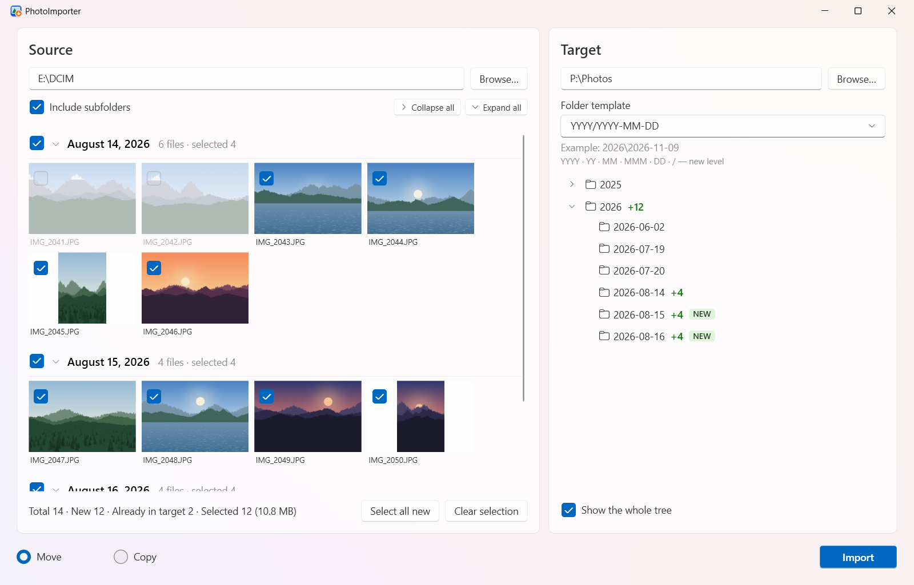

# PhotoShelver

**Move photos and videos from a memory card or phone into your library, sorted into folders by capture date — without ever losing or overwriting a file.**

A small, focused Windows 11 app in the spirit of Lightroom's Import dialog, without the catalog: your library stays plain folders that any program can read.

**[⬇ Download the latest version](https://github.com/maksim-m/PhotoShelver/releases/latest)** · Windows 11 (x64) · free and open source (MIT)



## Why

Copying a card by hand in Explorer is tedious and error-prone: you sort files into dated folders yourself, re-import the same shots because the card was never cleared, and Explorer's copy never checks that what landed on the disk is what was on the card. Full photo managers solve this, but pull you into their catalog and their way of working.

PhotoShelver does one job:

1. **Pick the source** (a card, a phone folder, a download folder) — you see every photo and video as a thumbnail, grouped by day.
2. **Pick the target** (your photo library) — you see the folder tree it will create, with the number of files going into every folder and **NEW** on folders that do not exist yet.
3. **Press Import.** Files are moved (or copied) into `2026/2026-08-14`-style folders, verified, and logged.

## Highlights

- **Sorted by the real capture date.** EXIF for photos; for videos the maker's own date where there is one — Apple's and Sony's date with time zone, the camera's clock of Canon (MP4 and MOV), GoPro, AVI cameras and AVCHD camcorders — otherwise the standard UTC time with the GPS position's time zone — so photos and videos from one moment land in the same folder. Files without metadata fall back to the modification date (and are marked). Also TIFF scans of any size (metadata beyond 2 GB, BigTIFF), and a damaged file can never crash the app.
- **Duplicates are recognised by content.** Files that are already in the library (from an earlier import) or appear twice on the card are dimmed and not selected — detected by a 128-bit content hash, not by name.
- **Your folder scheme.** `{YYYY}/{YYYY}-{MM}-{DD}` by default, or any template with `{YYYY}`, `{YY}`, `{MM}`, `{MMM}`, `{DD}` and `/` — text outside the braces is kept as is; mistakes are explained as you type, and an invalid template never lets the import start.
- **Optional second copy.** Under *Advanced*: every imported file is also copied to another folder — a folder per import with the card's own names (like Lightroom), or a mirror of the library. When moving, the card is cleared only after *both* copies are verified.
- **Optional renaming.** Under *Advanced*: a file name template such as `{YYYY}-{MM}-{DD}_{NAME}` → `2026-08-14_IMG_2041.JPG` (date, time `{HH}{mm}{ss}`, original name `{NAME}`). Off by default; when on, it stays visible even with the section collapsed.
- **Camera and phone formats.** JPEG, HEIC/HEIF (also Fujifilm .HIF), AVIF, JPEG XL, WebP, PNG, TIFF; RAW of every major maker (CR2, CR3, CRW, NEF, NRW, ARW, SR2, RAF, ORF, RW2, PEF, SRW, DNG, GPR, 3FR, IIQ and more); video MP4, MOV, 3GP, AVI, AVCHD (MTS/M2TS), MPG/MOD/TOD, MKV, Insta360 (.insv), GoPro MAX (.360), Canon CRM, MXF, BRAW, R3D. Camera proxies (GoPro .LRV/.THM, DJI .LRF) are left alone.
- **RAW-friendly.** RAW thumbnails come from the preview the camera embedded — fast and without installing codecs. TIFF scans are shown upright.
- **Fast on big cards.** Thousands of files are scanned in seconds; thumbnails load for what is on screen first. Disks are checked in the background, so a slow or sleeping one does not freeze the window.
- **Native look.** Windows 11 Fluent design, light and dark theme, English and Russian interface (follows the Windows display language).
- **One file, nothing to install.** A self-contained `PhotoShelver.exe`; the .NET runtime is inside.

## Safety first

Your photos are irreplaceable, so the importer is built around a few hard rules:

- **Nothing is ever overwritten.** A name clash gets a suffix: `IMG_0001_1.JPG`, `IMG_0001_2.JPG`, …
- **Every copy is verified before it counts.** The copy is read back from the disk bypassing the Windows cache and compared with the data that was read; the source is re-read from the card as well, which catches flaky card readers and cables.
- **A source is deleted only after its copy (and the second copy, if on) is verified and committed to the disk** — a power cut or a crash can never leave you with neither file. Write-protected cards and files protected in the camera are never deleted.
- **Files are copied under a temporary name** (`*.importing`) and get their real name only when complete, so an interrupted import never leaves a half-written photo looking like a real one.
- **Every import is logged** — which file went where, with its hash — in `%LOCALAPPDATA%\PhotoShelver\logs`.

These rules are enforced by tests that inject failures (full disk, card removed mid-copy, file changing while it is copied, bit rot after writing, sharing violations), by tests on real exFAT volumes, by end-to-end UI tests, and by a mutation check that deliberately breaks each safety rule and makes sure some test notices. The tests run on every change, the mutation check before every release.

## Download and run

1. Download **`PhotoShelver.exe`** from the [latest release](https://github.com/maksim-m/PhotoShelver/releases/latest) (about 70 MB).
2. Put it anywhere (e.g. `C:\Tools\PhotoShelver.exe`) and double-click it. Nothing is installed; the .NET runtime is inside the file. Requires Windows 11 (x64).
3. **The first start shows "Windows protected your PC"** (SmartScreen): the exe is not code-signed yet. Click **More info → Run anyway**. Windows remembers this for that file.

Optional: check that the download is intact — the release also has `SHA256SUMS.txt`; in PowerShell `Get-FileHash .\PhotoShelver.exe` must show the same value.

**Updating:** download the new `PhotoShelver.exe` and replace the old one; settings are kept.

**Where things are kept:** settings (last folders, templates, mode) in `%LOCALAPPDATA%\PhotoShelver\settings.json`, import logs in `%LOCALAPPDATA%\PhotoShelver\logs`, unexpected errors in `%LOCALAPPDATA%\PhotoShelver\errors.log`. **Removing it:** delete the exe and that folder.

**Problems or ideas:** [open an issue](https://github.com/maksim-m/PhotoShelver/issues); for an error, attach `errors.log` (and the import log, if it happened during an import).

## License

PhotoShelver is free software under the [MIT License](LICENSE): use, change and share it freely. It comes without any warranty — keep backups of photos that matter. It includes [third-party components](THIRD-PARTY-NOTICES.md) under their own (permissive) licenses.

---

# For developers

Everything below is about building, testing and releasing PhotoShelver.

## Setup

- Windows 11 (x64).
- [.NET SDK](https://dotnet.microsoft.com/download) — the exact version in `global.json` (currently 10.0.403).
- Optional: Python 3 for the tools (mutation check, fixtures, icon, demo library; the generators also need Pillow); the Windows feature "Windows Sandbox" for the sandboxed test run.

```powershell
dotnet build
dotnet test                       # core tests (xUnit)
dotnet run --project src/PhotoShelver.App
dotnet publish src/PhotoShelver.App -c Release -o publish   # the single-file exe, publish\PhotoShelver.exe
```

Local builds are version `0.0.0-dev`; releases get theirs from the tag (see [Releases](#ci-and-releases)).

## Layout

- `src/PhotoShelver.Core` — everything without UI: scanning, capture dates, hashing, duplicates, folder tree, import and its pre-checks.
- `src/PhotoShelver.App` — the WPF app.
- `tests/PhotoShelver.Core.Tests` — core tests; `tests/PhotoShelver.UiTests` — end-to-end UI tests.
- `tools/` — test runners, mutation check, test volumes, smoke test, icon and demo generators.
- `.github/workflows/` — CI, releases, mutation check.

## Tests

- **Core tests** — `dotnet test`. Every test works in its own folder under `%TEMP%\PhotoShelverTests`, which refuses paths outside itself.
- **UI tests** — the real window, driven through UI Automation and the real mouse; about a minute, don't touch the mouse meanwhile:
  `powershell -ExecutionPolicy Bypass -File tools/run_ui_tests.ps1`. They refuse to start the app unless every folder it gets (source, target, second copy, settings) is such a test folder; plain `dotnet test` skips them.
- **All tests in Windows Sandbox** — a disposable virtual machine that sees only `src`, `tests`, `tools` and .NET (read-only, no network): nothing on this computer can be touched, and the UI tests use the sandbox's own mouse, so you can keep working (~10 min). It also runs the tests on real exFAT volumes: two virtual disks created and formatted inside the sandbox (one write-protected, like a locked SD card), without administrator rights here:
  `powershell -ExecutionPolicy Bypass -File tools/run_tests_sandbox.ps1` (`-UiOnly`, `-CoreOnly`, `-VolumesOnly`)
- **A real card or USB disk** — set `PHOTOSHELVER_TEST_VOLUME` (see the header of `RealVolumeTests.cs`) and run `dotnet test --filter Category=RealVolume`.
- **Mutation check** — breaks each safety rule in turn and expects a failing test: `python tools/mutation_check.py` (`--ui` for the interface, `--only=<text>`, `--changed-since=<tag>`, `--shard=i/n`). A mutation no test notices is a gap in the tests; a snippet that no longer exists in the code stops the script (update it together with the code).
- **Smoke test of a published exe** — `powershell -ExecutionPolicy Bypass -File tools/smoke_test_exe.ps1 -Exe publish\PhotoShelver.exe`.
- **Test files** are synthetic (`tests/PhotoShelver.Core.Tests/Fixtures`, generated by `generate_fixtures.py`); format replicas of camera and phone files use the real structure with invented values. Real photos are never committed.

## CI and releases

- **CI** (`.github/workflows/ci.yml`) on every push to `main` and every pull request: build, core tests, UI tests, the exFAT volume tests (two virtual disks created on the runner, one write-protected — the runner is a disposable VM with administrator rights, like Windows Sandbox locally; `tools/create_test_volumes.ps1` serves both), and the published exe started once; the exe is attached to the run as an artifact (kept 14 days).
- **Mutation check** (`mutation.yml`): too long for every push (one full test run per mutation), so it runs before each release for what changed since the last one, and by hand in full (Actions → Mutation check → Run workflow). The plan is made on Linux; the parts run in parallel on Windows.
- **Releases** (`release.yml`): push a version tag from `main` — `git tag v1.2.0 && git push origin v1.2.0` (a pre-release: `v1.3.0-beta.1`). All CI checks run, together with the mutation check of the mutations a change since the last release can affect (their file, their tests or the mutation list changed); a mutation the tests no longer catch stops the release. Then the exe is built with that version, started once, and published as a GitHub Release with `SHA256SUMS.txt`, `LICENSE` and `THIRD-PARTY-NOTICES.md`. The exe is not code-signed yet.
- **Build rules**: warnings are errors; the .NET SDK is pinned exactly in `global.json` (the SDK brings some packages of its own version, which are in the lock files too; to move to a newer SDK, change the version there and run `dotnet restore --force-evaluate`); NuGet packages are locked in `packages.lock.json` (CI restores with `--locked-mode`) — after changing a package, run `dotnet restore --force-evaluate` and commit the updated lock files. A new dependency also needs its entry in `THIRD-PARTY-NOTICES.md`.

## Languages

Windows' display language decides when there is a translation for it, English otherwise; `PHOTOSHELVER_LANG=ru|en` overrides it. The texts are in `src/PhotoShelver.Core/Strings.resx` (English) and `Strings.ru.resx` (Russian).

**Adding a language:** copy `Strings.resx` to `Strings.<language code>.resx` (e.g. `Strings.de.resx`) and translate the values — nothing else to change. Keep `{0}`, `{1}`… and the tokens in braces (`{NAME}`, `{YYYY}`…) as they are; `FileOne` / `FileFew` / `FileMany` are the plural forms of “file”. A test checks that every text exists in every language with the same `{0}`, `{1}`….

## Assets

- The icon (`src/PhotoShelver.App/Assets/app.ico`) is drawn by `python tools/make_icon.py`.
- The screenshots use a demo card and library (drawn landscapes, no real photos) made by `python tools/make_demo_library.py <empty folder>`.
